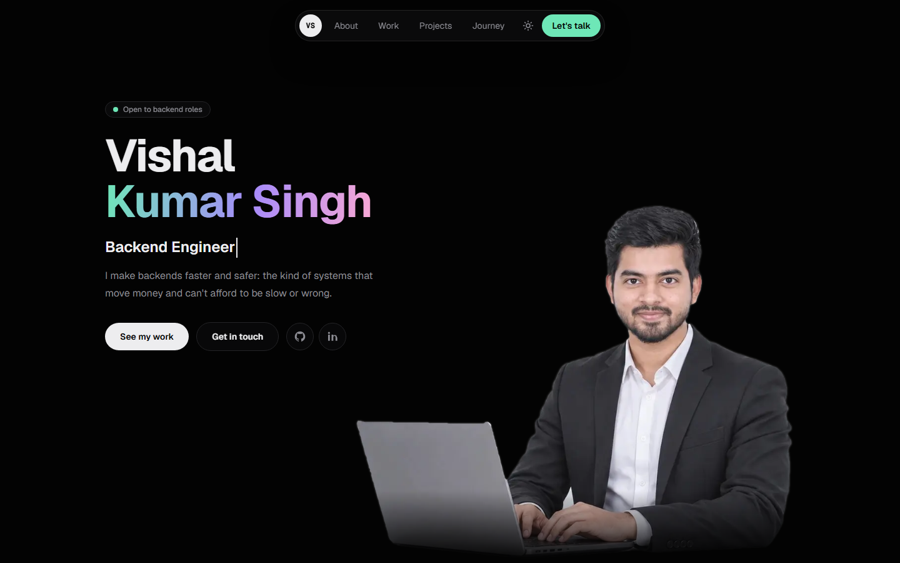
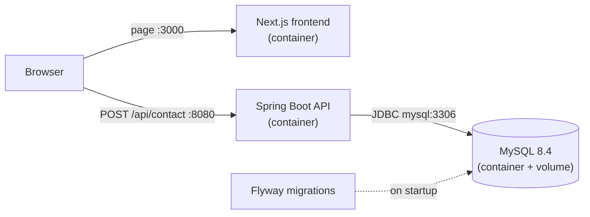

# Portfolio — Vishal Kumar Singh

A full-stack personal portfolio built like a production system: a **Next.js** frontend, a layered **Spring Boot** API backed by **MySQL**, everything containerised with **Docker**, and a step-by-step path to **CI/CD, AWS and Kubernetes**.




---

## Architecture



The site is server-rendered by Next.js. The contact form posts from the browser to the Spring Boot API, which validates the message and stores it in MySQL. The schema is versioned with Flyway and applied automatically when the API starts.

---

## Features

**Frontend**
- Dark / light theme switch (no flash on load; preference saved per visitor)
- Photo hero, quick-facts strip with live local time, count-up impact numbers
- Experience tabs, project case studies, "learning in public" DevOps roadmap
- Contact form with per-field validation errors from the API
- Responsive down to phone width; respects reduced-motion settings

**Backend**
- `POST /api/contact` with Bean Validation and RFC 9457 problem-details errors
- Honeypot spam filter (bots are dropped silently)
- CORS restricted to the frontend origin (configurable via env)
- Actuator health with liveness / readiness probes (used by Docker, later ECS/Kubernetes)
- No personal data in logs

---

## Tech stack

| Layer | Technology |
|---|---|
| Frontend | Next.js 16 (App Router), React 19, TypeScript, Tailwind CSS 4 |
| Backend | Java 21, Spring Boot 4.2 (Web MVC, Validation, Data JPA, Actuator) |
| Database | MySQL 8.4, Flyway migrations, Hibernate (`ddl-auto=validate`) |
| Testing | JUnit 5, Mockito, MockMvc, Testcontainers (real MySQL) |
| Containers | Multi-stage Dockerfiles, Docker Compose |

---

## Backend design

Feature-first packages, with clear layer boundaries inside each feature:

```
dev.vishal.portfolio
├── contact/
│   ├── controller/   ContactController        HTTP only: route, status, @Valid, delegate
│   ├── dto/          ContactRequest/Response  API input/output shapes
│   ├── service/      ContactService           interface (business contract)
│   │   └── impl/     ContactServiceImpl       business rules
│   ├── repository/   ContactRepository        DAO interface
│   │   ├── impl/     JpaContactRepository     MySQL implementation
│   │   └── jpa/      Spring Data repository
│   ├── entity/       ContactMessageEntity     JPA mapping
│   ├── model/        ContactMessage           domain model (no framework annotations)
│   └── mapper/       ContactMapper            DTO ⇄ model
└── common/
    ├── config/       CORS, Clock
    └── exception/    GlobalExceptionHandler   one place for all error responses
```

Controllers and services depend on **interfaces**, so storage was swapped from in-memory to MySQL without touching either of them.

---

## Getting started

**Prerequisites:** Docker Desktop. (For running outside Docker: Java 21+ and Node.js 20+.)

### Run everything with Docker
```bash
docker compose up -d --build
```
| Service | URL |
|---|---|
| Website | http://localhost:3000 |
| API | http://localhost:8080 |
| Health | http://localhost:8080/actuator/health |
| MySQL | `localhost:3307` · db `portfolio` · user/password `portfolio` *(local only)* |

Stop with `docker compose down` (data is kept in a volume; `down -v` wipes it).

### Run for development
```bash
# 1. Database only
docker compose up -d mysql

# 2. Backend (from backend/)
./mvnw spring-boot:run

# 3. Frontend (from frontend/)
npm install
npm run dev
```

### Tests
```bash
cd backend && ./mvnw test      # needs Docker running (Testcontainers starts MySQL)
cd frontend && npm run lint
```

---

## API

Base URL: `http://localhost:8080`

### `POST /api/contact`
```json
{ "name": "Asha", "email": "asha@example.com", "message": "Hi Vishal, let's talk about a role." }
```
| Field | Rules |
|---|---|
| `name` | required, ≤ 80 chars |
| `email` | required, valid email, ≤ 120 chars |
| `message` | required, 10–2000 chars |

| Status | Body |
|---|---|
| `202 Accepted` | `{ "id": "…uuid…", "status": "received" }` |
| `400 Bad Request` | `{ "title": "Invalid request", "errors": { "email": "That doesn't look like a valid email" } }` |

### Health
`GET /actuator/health` · `/actuator/health/liveness` · `/actuator/health/readiness` → `{ "status": "UP" }`

---

## Configuration

The backend reads these environment variables (local defaults in parentheses):

| Variable | Purpose |
|---|---|
| `DB_URL` | JDBC URL (`jdbc:mysql://localhost:3307/portfolio`) |
| `DB_USERNAME` / `DB_PASSWORD` | Database credentials (`portfolio` / `portfolio`) |
| `APP_CORS_ALLOWED_ORIGINS` | Allowed frontend origins (`http://localhost:3000`) |

The frontend reads `NEXT_PUBLIC_API_URL` **at build time** (`http://localhost:8080`).

---

## Roadmap

- [x] Next.js frontend
- [x] Spring Boot API with layered architecture
- [x] MySQL + Flyway
- [x] Dockerfiles + Docker Compose
- [ ] CI with GitHub Actions (tests, image builds)
- [ ] Redis rate limiting on the contact form
- [ ] Kafka: async email notifications
- [ ] AWS deployment: ECR, ECS Fargate, RDS MySQL
- [ ] Kubernetes manifests

---

## Author

**Vishal Kumar Singh**: Backend Engineer (Java, Spring Boot)
[LinkedIn](https://linkedin.com/in/vishal-kumar-singh) · [GitHub](https://github.com/Vishu2001)
